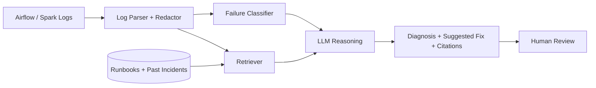

# LLM Pipeline Intelligence Assistant

**Paste a failed pipeline log and get the likely root cause, a suggested fix, and a link to the evidence, in seconds.**

  

## The Problem

On-call data engineers lose hours reading long Airflow and Spark logs to find one line that explains a failure. The same failures repeat (schema changes, OOM errors, expired credentials), but the knowledge lives in people's heads and old Slack threads.

## The Idea

An assistant that:

1. **Parses** logs and extracts the relevant error section
2. **Classifies** the failure (schema drift, resource limits, auth, data quality, upstream delay)
3. **Retrieves** similar past incidents and your team's runbooks (RAG)
4. **Suggests** a fix with citations back to the exact log lines
5. **Never auto-applies anything**. A human approves every action.

## What Makes It Different

- **Evaluation first:** includes a labeled set of failure logs and a script that reports real accuracy
- **Grounded answers:** every suggestion points to log lines or runbook sections; no evidence means "unknown"
- **Safe by design:** read-only access, secrets redacted before any text is sent to an LLM

## Architecture



## Tech Stack

Python, FastAPI, an LLM API (configurable), a vector store (Chroma), sentence-transformers, pytest, Docker

## Quick Start

```bash
git clone https://github.com/Ghazi1212/llm-pipeline-intelligence-assistant.git
cd llm-pipeline-intelligence-assistant
pip install -r requirements.txt
cp .env.example .env              # add your LLM API key here, never commit it
python -m assistant.cli analyze examples/spark_oom.log
```

## Example Output

```
Failure type : Resource limit (executor out of memory)
Evidence     : line 412 "java.lang.OutOfMemoryError: Java heap space"
Likely cause : Skewed join on customer_id
Suggested fix: Enable AQE skew handling or salt the join key
Similar past : INC-014 (resolved by increasing shuffle partitions)
Confidence   : medium
```

## Evaluation

```bash
python -m assistant.eval --dataset data/labeled_failures.jsonl
```

| Metric | Result |
|---|---|
| Classification accuracy | TBD |
| Suggestions rated useful (manual review) | TBD |
| Cases correctly answered "unknown" | TBD |

> Results are published only after running the eval script on a dataset of real or realistic logs.

## Roadmap

- [x] Log parser and secret redaction
- [ ] Failure classifier
- [ ] RAG over runbooks
- [ ] Evaluation harness
- [ ] Slack bot

## License

MIT
